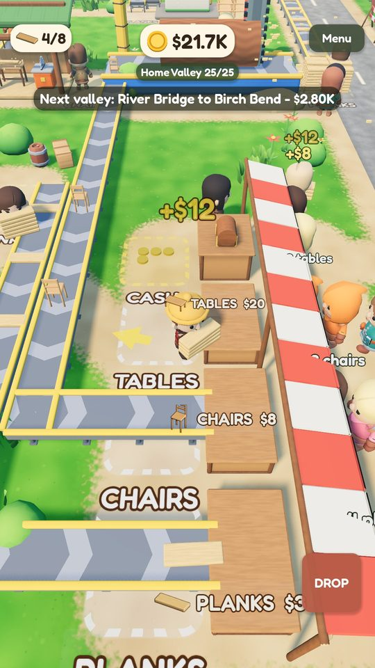
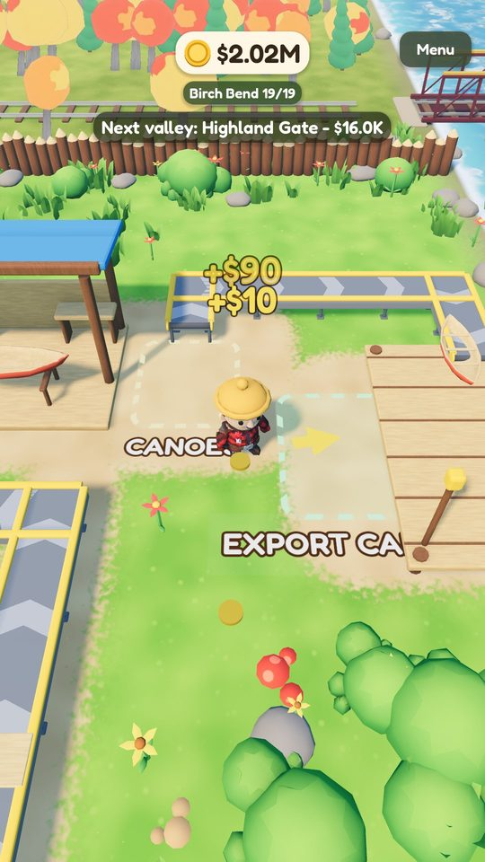
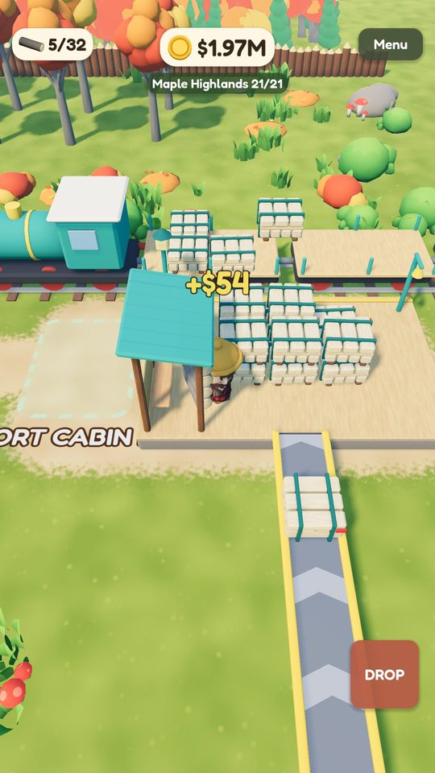
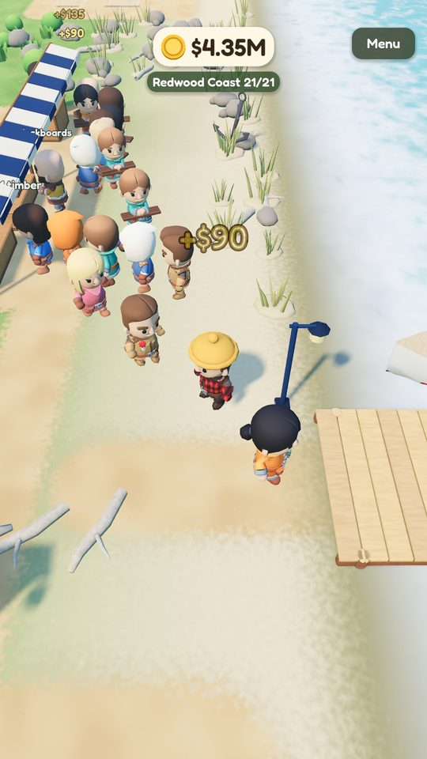
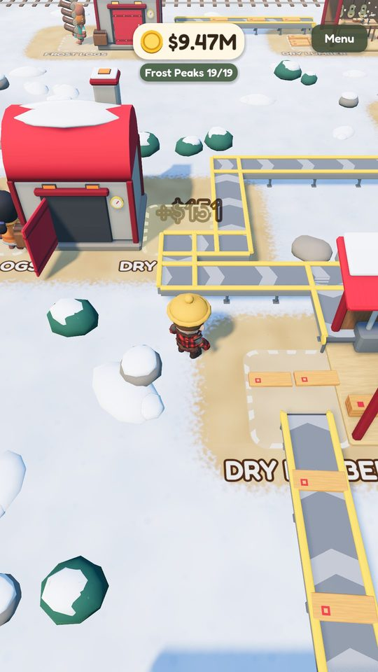
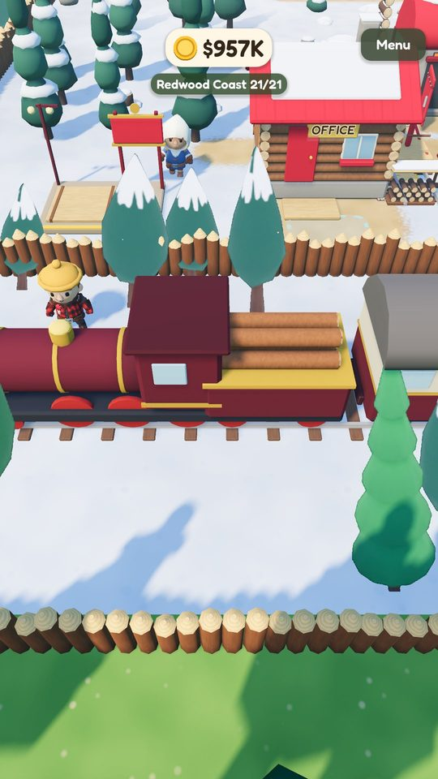

# Timber Valley

A calm lumber mill game for Android. You chop trees, saw logs into planks,
sell them at a market by the road, and spend the money on new machines,
workers and factories. The mill grows from one lumber yard into five
connected valleys and a grand station at the end.
**No ads, no in-app purchases, no timers, no analytics.**

It is a clean version of the "idle arcade" mini-games you see in mobile ads
(Pizza Ready, Idle Lumber and similar): the part of the ad that looks fun,
without the ad-supported game wrapped around it.

<p align="center">
  
  
  
</p>
<p align="center">
  
  
  
</p>
<p align="center"><em>Gameplay from the current build: the five valleys and the Grand Timber Express.</em></p>

## Download

**Direct APK download:**
https://github.com/Matswm86/timber-valley/releases/download/latest/timber-valley.apk

1. Open that link in your phone's browser and tap to download.
2. When you open the file, Android may ask you to allow installs from this
   source. Tap **Settings**, turn on **Allow from this source**, go back and
   install.
3. The app appears as **Timber Valley**.

The APK is debug-signed with a stable key, so a newer build installs over an
older one and keeps your save. It holds 64-bit and 32-bit ARM builds, so
32-bit Android tablets can install it too.

## How to play

Drag anywhere on the screen to walk. Everything else happens by standing on
things:

| Stand on or next to | What happens |
|---|---|
| A tree | You chop it; the logs stack up in your arms |
| A white square marked LOGS | You drop logs into the machine |
| A square marked PLANKS, CHAIRS... | You pick up what the machine made |
| A market counter | You stock it; shoppers walk in from the road and buy |
| CASH | You collect what the shoppers paid |
| A dark tile with a plus sign and a price | You pay for the next building or worker |
| UPGRADES | The upgrade shop opens |
| A build site square | You hand over the goods it asks for; its sign shows how many are in |
| A handcar tile | You ride to that valley's hub |

A drop button appears at the bottom right while you carry something, and puts
the load down. A yellow arrow at your feet points to the next useful thing, so
you never have to wonder what to do. Progress saves by itself. If you close the
app, your valleys keep earning: up to two hours at half rate wait as a coin pile
at the Home Valley office when you come back.

## What you can build

108 purchases, from $10 to $1,200,000, unlocked a few at a time. Five valleys
open one after another. Each has its own wood, its own machines and one new
idea, and the older valleys keep earning while you work in a new one.

| Valley | Wood | Makes | New idea | Landmark |
|---|---|---|---|---|
| 1. Home Valley | broadleaf, pine | planks, chairs, tables, bookcases | the basics, conveyors, a truck dock | Grand Lodge |
| 2. Birch Bend | birch | veneer, plywood, canoes | a log flume, a barge | Boathouse |
| 3. Maple Highlands | maple | beams, floorboards, cabin kits | build sites, village houses that pay rent, a train | Clock Tower |
| 4. Redwood Coast | redwood | timber, deckboards, masts, ships | cargo orders, ships launched from slipways | Lighthouse |
| 5. Frost Peaks | frost fir | dry lumber, skis, sleds, guitars | batch drying kilns, a cable car | Summit Observatory |

Each landmark finishes its valley and shows the gateway to the next step; the
last one leads to the station. Every valley has its own market and upgrade
office, and Valleys 2 to 5 add Sharp Saws, Crew Coffee and Local Fame upgrades
that only apply there. Workers are lumberjacks and carriers everywhere, plus
forklifts, log skidders, shipwrights and snowcats in the valleys that need them.

**Home Valley** has 26 purchases, from $10 to $6,000:

- **Forests**: more broadleaf trees, a pine forest, a north forest.
- **Machines**: two chainsaw sawmills (log to planks), a carpentry (planks to chairs),
  a CNC workshop (planks to tables), a robot furniture factory (logs to
  bookcases).
- **Workers**: lumberjacks who chop and deliver logs, carriers who move goods
  between machines and the market, and a cashier who collects the money.
- **Big machinery**: the MEGA sawmill, where a crane drops giant logs onto a
  belt and a huge chainsaw slices them into planks nonstop.
- **Automation**: seven conveyor belts (sawmills to the market, to the
  carpentry and the CNC, chairs and tables to the market, factory to the
  dock), and a truck dock where a truck loads bookcases and pays on the way out.
- **Shoppers**: more stock on the counters brings more shoppers, and a road
  sign brings even more, so the counters never clog.
- **Upgrades**: bigger backpack, faster shoes, sharper axe, faster machines,
  faster workers, better prices.
- **The Grand Lodge**: the landmark of Home Valley. It finishes the valley and
  opens the river bridge to Birch Bend.

**The Grand Timber Station** is the last purchase ($1,200,000). Each valley
gets a platform that wants its own goods. When all five are full, the Grand
Timber Express runs a loop past every valley and the game says the five valleys
are connected. Orders and ships keep running if you want to stay.

## How it works

Timber Valley is a Godot 4.6 project written in GDScript, exported to Android
with Godot's Gradle build. The world is built from code at start-up from one
list of purchases, and the shared wallet, the unlocks and the save file live in
one global game-state script. It draws real-time 3D with the Mobile (Vulkan)
renderer: soft sun shadows, drifting cloud shadows, a flowing river, logs with
bark and end-grain rings, grained planks, log palisade fences, running chainsaw
teeth, animated characters, wood chips when you chop, and a carried stack that
sways as you walk. To fit a phone, only two valleys are awake at a time; a
sleeping valley is switched off and pays its recent average income into the
wallet, and the same ledger pays the offline earnings. The music loop and forest
ambience come from `tools/make_music.py` (numpy, scipy and soundfile, no
samples); sound effects are CC0 packs from Kenney.

## Status

Version 0.1.0: playable from the first tree to the Grand Timber Station. Builds
are sideload only (debug-signed, not for store distribution), and some balance
calls are still open (see the end of `docs/GDD.md`).

## Credits

- 3D models: [KayKit](https://www.kaylousberg.com) packs by Kay Lousberg (CC0),
  reworked here: Forest Nature Pack, Character Pack: Adventurers, Medieval
  Hexagon Pack. All other models are own work built in Blender and released CC0
  with this repo. Per-file sources are in `assets/models_v3/SOURCES.md`.
- Sound effects: [Kenney](https://kenney.nl) (CC0): Impact Sounds, Interface
  Sounds, RPG Audio, Casino Audio.
- Font: [Fredoka](https://github.com/google/fonts/tree/main/ofl/fredoka)
  (SIL Open Font License, see `assets/fonts/OFL.txt`).

## Run from source

1. Install **Godot 4.6.x** from https://godotengine.org/.
2. Import `project.godot` and press **F5**. On desktop, WASD or the arrow keys
   walk, and the mouse works as a touch.

`tests/capture.tscn` is a dev-only scene (not exported) that plays the
tutorial with a bot, unlocks everything and saves screenshots. Run it under
Xvfb with `CAPTURE_DIR=/some/dir`; add `CAPTURE_MODE=shots` to skip the bot.

`tests/kidui_capture.tscn` shoots every HUD screen with a button and measures
each button (216 px touch areas, nothing in the bottom 256 px, top-left
232 px free), standalone, inside a host app and with a fake camera cutout.
`tests/reentry_test.tscn` (headless) checks that loading the save again pays
offline earnings only once.

## Running inside a host app

Progress is saved to `user://timber_valley_save.json` (an older
`user://save.json` is moved there on first start). A host app (MWM Play) sets
one flag before it loads `scenes/Main.tscn`:

```gdscript
Engine.set_meta(&"mwm_play_shell", true)   # remove_meta when the game closes
```

With the flag the game hides its own menu (sound, music, start over), ignores
its saved mute, never mutes the Master bus and always plays. `Game.load_game()`
is safe to call again on every enter. Without the flag (the standalone APK)
nothing changes.

## Build

GitHub Actions builds the APK on every push to `main`
(`.github/workflows/build-android.yml`) and publishes it to the rolling
`latest` release. Pushing a `vX.Y.Z` tag creates a versioned release.
